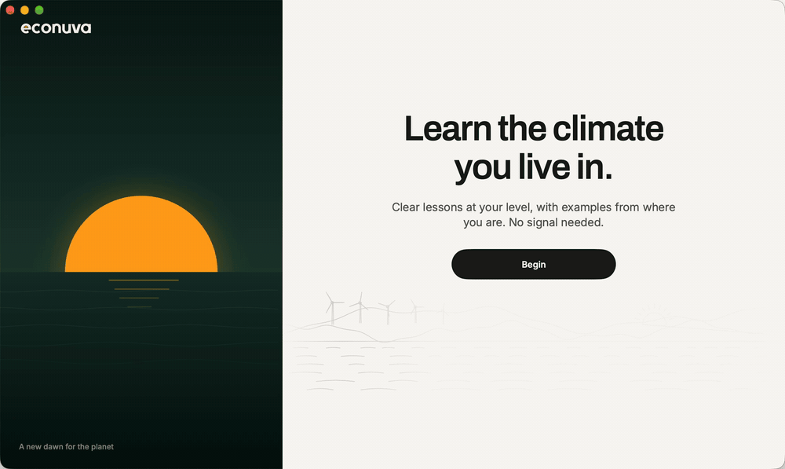

  

# Econuva

Econuva is a climate and sustainability learning app for the Mac. Its courses adapt to the country you live in and to the depth you choose, and every one of them works offline. With [Kalon](https://github.com/KalonEdge/kalon) running on your Mac, Econuva can also answer your questions and draft new courses on any climate topic.

[Download Econuva](https://github.com/KalonEdge/Econuva/releases/latest/download/Econuva.dmg) for macOS 15 or later, on Apple silicon and Intel.

## Features

- 51 courses and 350 lessons on climate science, adaptation, cutting emissions, carbon markets, climate finance, the UN climate talks from Paris to COP31, nature, health, food, water and energy.
- Four depths, from Deckhand for families to Admiral for experts. The same science is written four ways, and you can switch depth in the middle of a lesson.
- Lessons that know where you are. Pick your country, one of 195, and lessons name your weather service, your disaster agency, the hazards you face, the crops you grow and your national climate plan, with local examples from your part of the world.
- A short check after every lesson, review cards for the words you have learned, a glossary and the sources behind every lesson.
- Studio turns any course into a presentation you can show full screen or export to PowerPoint.
- Ranks, badges and a record of what you have learned.
- With Kalon: ask about any lesson, make quizzes, flashcards and presentations in a conversation, or draft a new course on a topic you choose. Courses drafted by Kalon are labelled as drafts so you know to check them against their sources.

## Install

Download the disk image from the [latest release](https://github.com/KalonEdge/Econuva/releases/latest), open it, and drag Econuva into Applications. The app is signed and notarized by Apple.

## Kalon

Econuva works on its own. To ask questions, make quizzes and draft courses, run [Kalon](https://github.com/KalonEdge/kalon) on your Mac or on a Kalon hub on your network. Econuva finds it automatically, and everything you ask stays on your own devices.

## Updates

Econuva looks for a new version once a day and asks before installing it. Each update is signed, and Econuva won't install one that isn't. You can also choose Check for Updates from the Econuva menu.

## Privacy

Your progress, conversations and settings are stored encrypted on your Mac, with the keys kept in your Keychain. Econuva connects only to GitHub to check for updates and to Kalon on your own Mac or network. It has no accounts, no analytics and no servers of its own.

## Sources

Every lesson lists its sources: the IPCC, WMO, UNFCCC, UNEP, the World Bank, FAO, NASA, NOAA, national weather services and other public bodies. Country facts come from the World Bank Climate Change Knowledge Portal, the UNFCCC NDC registry, Our World in Data and FAO.

## Support

Please report bugs and requests in [Issues](https://github.com/KalonEdge/Econuva/issues).

© 2026 KalonEdge
